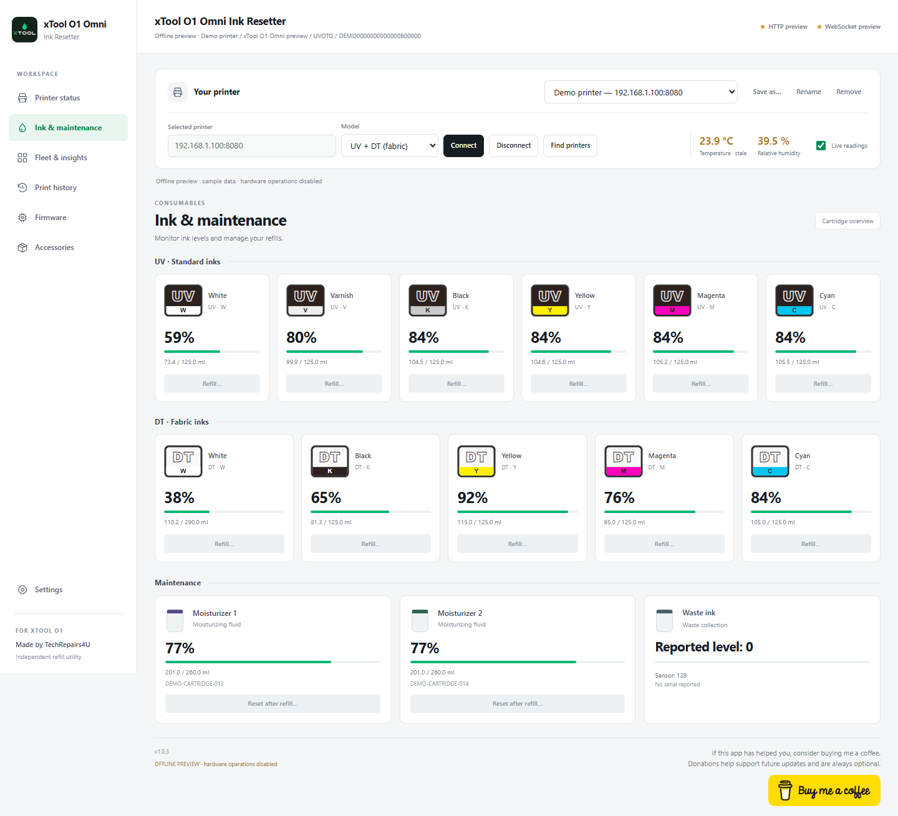
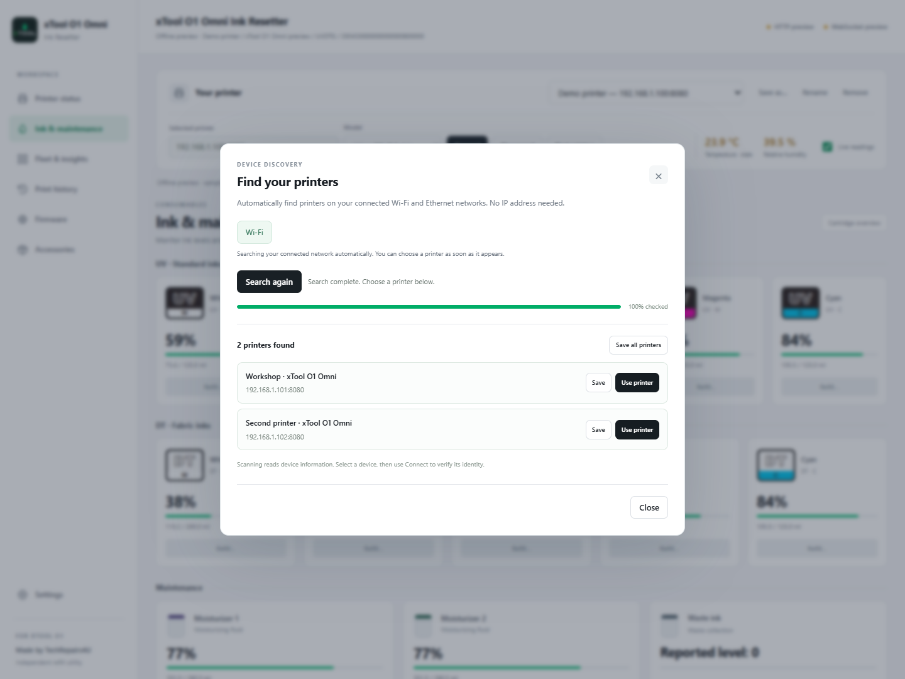

# xTool O1 Omni Ink Resetter

**Version 1.0.3 · Made by TechRepairs4U**

A Windows app for viewing your xTool O1 Omni printer's ink levels and manually resetting the recorded level after you have refilled a cartridge.



*UV + DT layout shown with sample readings in offline preview.*

## Download

[Download xTool O1 Omni Ink Resetter v1.0.3 for Windows](https://github.com/TechRepairs4U/xtool-o1-omni-ink-resetter/releases/download/v1.0.3/xTool-O1-Omni-Ink-Resetter-v1.0.3.exe)

Download the `.exe` and open it on a Windows PC. Connect the PC to the same local network as your printer.

## What it does

- Shows the ink levels and maintenance-tank information reported by your printer.
- Automatically detects your connected Wi-Fi/Ethernet networks, finds printers and lets you save them.
- Lets you manually update a cartridge's recorded ink level after refilling it.
- Provides layouts for **Single UV**, **Dual UV**, and **UV + DT (fabric)**.
- Shows the Dual UV expansion inks separately: **Rigid White (RW)**, **Flexible White (FW)**, **Fluorescent Red (FR)** and **Fluorescent Yellow (FY)**.

## Getting started

1. Choose your printer model.
2. Click **Find printers**. The search starts automatically — no IP address or network range to enter.
3. Choose **Use printer**, then click **Connect**. If a pairing message appears, press the printer's illuminated **Start/Stop button once** and keep the app open.
4. Open **Ink & maintenance** to view the cartridges.
5. After physically refilling a cartridge, use its **Refill** button and follow the confirmation steps.

You can choose a result before the scan finishes, stop the search, or save several printers. **Search again** detects the current network if you have changed Wi-Fi.



*Search layout shown with sample results.*

Network search checks connected private Wi-Fi/Ethernet networks. It cannot find a printer at another location over the internet, and guest Wi-Fi isolation or a VPN may prevent discovery. Very large networks are limited to the nearest 65,536 addresses, with the limit shown in the app.

## Pairing with your printer

The pairing screen now shows a circular button with a spinning light-blue ring while waiting for confirmation. Press the illuminated **Start/Stop button on the physical printer once**, then keep the app open. The ring stays still if reduced motion is enabled on your PC.


*Pairing-screen preview; no printer is connected in this illustration.*

### Printer login update from version 1.0.1

This update adds the newer printer-confirmed pairing flow to address **406 guest login rejected** errors on firmware that requires pairing. Successful pairing is remembered for future connections. The app now waits for you to click Connect and keeps any connection error visible so it can be shared for troubleshooting.

The included engine has been updated to upstream 1.0.31. Pairing was introduced upstream for firmware V0.14.11, with the older login retained for V0.13.1. The affected physical printer still needs to be tested; if the error continues, share the full message and your printer's firmware version.

## Support the app

If this app has helped you, consider buying me a coffee. Donations help support future updates and are always optional.

<a href="https://www.buymeacoffee.com/TechRepairs4u"></a>

## Before using it

Resetting the displayed level does not add ink. This app does not make cartridges chipless and does not automatically reset them when removed and reinserted.

The interface, build and simulated pairing flow have passed offline checks, and the Windows app has been launched successfully. Discovery, connection and ink resets still need testing with a physical printer, so compatibility with every firmware version is not confirmed.

This is an independent utility by TechRepairs4U, not an official xTool application. This repository contains the Windows download and usage information; source code is not published here.

## File verification

SHA-256 for `xTool-O1-Omni-Ink-Resetter-v1.0.3.exe`:

```text
e3f0ab2e129bd63a2fb47d3f55990272c09ad59424696f068a78a74153779a5e
```
